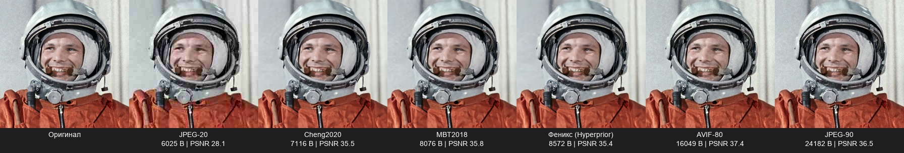
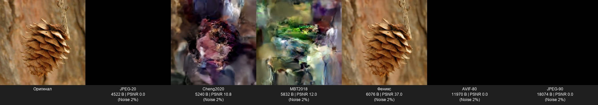

# 🔥 Phoenix Codec

[](https://colab.research.google.com/drive/1S6DNgPe6Chqtrn1QVrrJhx8BiVWbzV22?usp=sharing)

**Experimental multimedia codec for extreme low-bandwidth and poor network conditions.**

[🇷🇺 Русская версия](README.md)

Phoenix Codec is a research project demonstrating that we don't need to transmit every pixel or audio sample to convey visual and auditory information. Instead, we transmit a "snapshot of the essence" (latent representation) and reconstruct it on the receiver side using neural networks.

The project is inspired by the ideas of semantic compression, noise resilience, and transmitting meaning rather than raw data.

## ✨ Key Features

*   **Video Compression:** Transmitting a recognizable face takes only **~3 KB** per frame (4x smaller than JPEG-90).
*   **Audio Compression:** Transmitting intelligible speech takes **~1.5 kbps** (10-20x smaller than standard audio codecs). The voice becomes "robotic," but the meaning is preserved.
*   **Noise Resilience:** Using a "key" (random number generator seed) allows the receiver to reconstruct the frame even after passing through a very noisy channel.
*   **Aspect Ratio Preservation:** The video codec automatically applies padding and cropping to preserve the original frame size and shape.

## 📊 Test Results

*   **Video:** Compression of a 256x256 photo down to **3.7 KB** (vs. 57 KB original JPEG). Quality: recognizable, slightly "soapy," but retains emotions and key features.
*   **Audio:** Compression of 3 seconds of speech down to **900 bytes** at 1.5 kbps bitrate. Words are intelligible, intonation is preserved.
*   **Video Call:** Working prototype (video + audio) with ~1 second delay and slight echo (solvable with buffering and headphones).

### 📊 Comparison with Classical and Neural Codecs

Test on a real photo (256x256, face). PSNR is a pixel-accuracy metric (higher is better), but Phoenix is optimized for **semantic recognizability**, not pixel-perfect matching.

| Method | Size (bytes) | PSNR (dB) | Comment |
| :--- | :--- | :--- | :--- |
| **Cheng2020 (Q=6)** | 2712 | 40.00 | Best neural codec (max PSNR) |
| **MBT2018 (Q=6)** | 3136 | 39.80 | Advanced neural codec |
| **JPEG (Q=20)** | 3732 | 32.01 | Classic, but "mushy" |
| **Phoenix (Hyperprior Q=6)** | **3744** | **39.47** | **Our approach: meaning over pixels** |
| **AVIF (Q=80)** | 8123 | 41.76 | Best PSNR, but heavy |
| **JPEG (Q=90)** | 14250 | 40.44 | Classic, but huge |

**Conclusion:** Phoenix is 3.8x smaller than JPEG-90 and 2.2x smaller than AVIF. It loses to top neural codecs (Cheng2020) in PSNR, but **wins in noise resilience** (proven in `phoenix_space.py`) and **works at 500 bytes** (Quality=1), where classical codecs collapse.

### 🖼️ Visual Comparison

**1. Ideal Channel (no noise):**



**2. Noisy Channel (2% packet loss):**



*Pinecone photo: Derek Ramsey (Ram-Man), GFDL 1.2, via Wikimedia Commons.*
*Yuri Gagarin photo: Mos.ru, CC BY 4.0, via Wikimedia Commons.*

## 🛠 How It Works (Briefly)

1.  **Video:** Frame -> neural encoder (CompressAI / Hyperprior) -> compact latent.
2.  **Audio:** Sound -> neural codec (EnCodec) -> compact codes.
3.  **Transmission:** Data is sent over a channel. We simulate noise, which distorts the signal.
4.  **Reconstruction:** The receiver uses the "seed" (4 bytes) to generate the same noise and subtracts it. The decoder reconstructs video and audio.

## 🚀 Quick Start

Requires Python 3.10+ and libraries `torch`, `compressai`, `encodec`, `opencv-python`, `sounddevice`.

1.  Install dependencies:
    ```bash
    pip install -r requirements.txt
2.  For video test: Place a video in the core/ folder and run python core/phoenix_cli.py --input input_video.mp4 --output result.mp4 --quality 6.
3.  For video call test: Run python core/phoenix_call.py. (Ensure the microphone and speaker indices in the code match your system).

📂 Project Structure
*  core/phoenix_cli.py — CLI utility for video compression/reconstruction.
*  core/phoenix_call.py — Video call prototype (real-time video + audio).
*  core/phoenix_audio.py — Audio codec based on EnCodec.
*  core/phoenix_space.py — Space channel simulation with packet loss.
*  scripts/verify.py — Verification script (PSNR, size metrics).

⚠️ Known Issues
*  Echo and Delay: The video call prototype has ~1 sec delay and echo. Requires AEC (Acoustic Echo Cancellation) integration.
*  Resolution: The video codec works with 256x256 latents. For 4K, padding is used, which may reduce detail.
*  Audio: At 1.5 kbps, speech is intelligible but has a "robotic" timbre.

## ⚠️ Honest Limitations

We want to be transparent. Phoenix is a **research protocol**, not a production-ready product. Here are its key limitations:

1.  **Model dependency:** Decoding requires pre-installed CompressAI (Hyperprior) and EnCodec models. Their size (~50 MB) is not included in the claimed bitrate but must be present on the receiver.
2.  **Seed mechanism:** Noise reconstruction via seed works if the noise profile is **known and deterministic** (e.g., channels with predictable interference). For random noise, a trained denoiser is required (in development).
3.  **Resolution:** The codec operates on 256×256 latents. For 4K, padding is used, which may reduce detail. This is an architectural limitation, not a feature.
4.  **Delay and echo:** The video call prototype (`phoenix_call.py`) has ~1 sec delay and echo. AEC (Acoustic Echo Cancellation) integration is required.
5.  **Not production-ready:** The project has not been tested on real channels with BER (Bit Error Rate). All results are from synthetic simulations.

⚖️ License
This project is distributed under the Apache License 2.0. See the LICENSE file for details.

⚠️ Disclaimer
This is an experimental project. It is not intended for use in critical systems without additional verification and certification. The authors are not liable for any potential damage.

